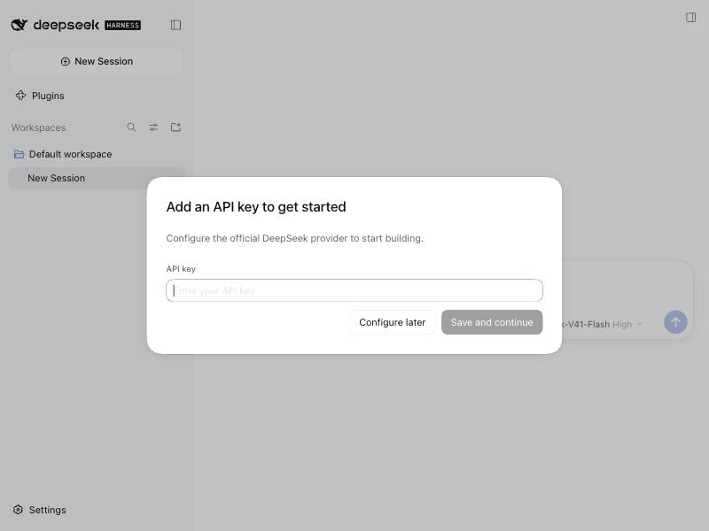
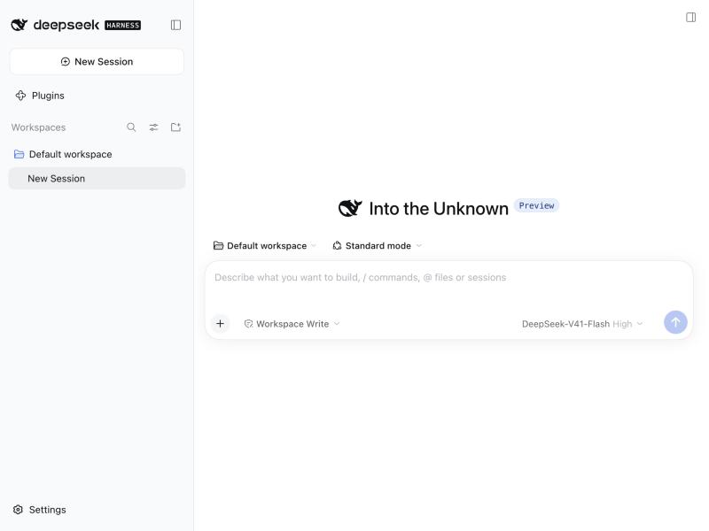
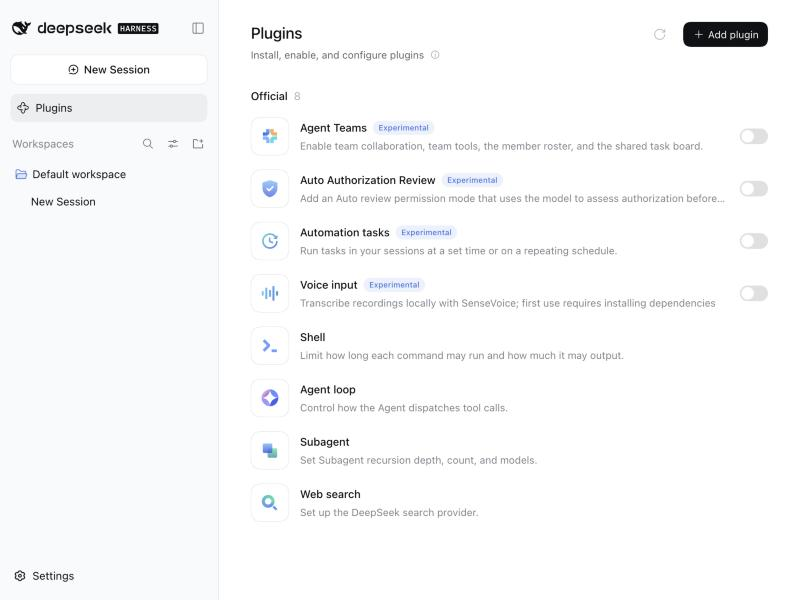
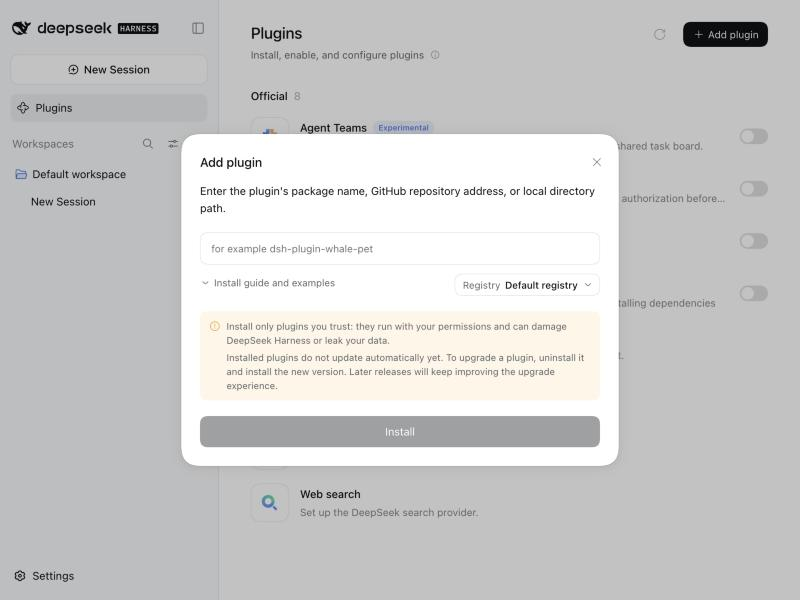

# Part B — DeepSeek Harness (DSH): Creator Mode + Plugins

Install the **DeepSeek Harness** (`dsh`), run it in **creator mode**, enable a suite of
plugins, and **implement two plugins from scratch** against the real Cordis plugin API.

> DSH is DeepSeek's open-source "everything is a plugin" agent harness, built on the
> **Cordis** kernel. Docs: <https://github.com/deepseek-ai/deepseek-harness> ·
> book: <https://books.vizuara.ai/read/deepseek-harness>

---

## 1. Install & run DSH

```bash
# quickest: run the published package (starts the Web UI at http://127.0.0.1:3080)
npx -y @deepseek-ai/dsh@latest web

# or from source (needed for the --patch dev-loading method below)
git clone https://github.com/deepseek-ai/deepseek-harness.git
cd deepseek-harness && pnpm install && pnpm run build
pnpm dsh web
```

On first launch it asks for a **provider API key** (the official DeepSeek provider, or any
configured provider). Add your DeepSeek key, or click **Configure later** to explore the UI.

| First run | Main UI |
|---|---|
|  |  |

> ⚠️ **You need a DeepSeek (or compatible) API key to actually chat / run the plugin demos.**
> Everything else here — install, the plugin manager, authoring and loading the two custom
> plugins, and the offline plugin smoke test — works without one.

---

## 2. Creator mode

Creator mode exposes read-only **Cordis inspection tools** (`@deepseek-ai/dsh-tool-cordis`)
so you can inspect the Host/Client runtime APIs *before* writing plugin code, test a plugin
composition in memory (define → run → inspect trajectory → undefine), and promote only what
survives. Enable it from **Settings → advanced/developer features**, then open a session in a
creator-enabled mode. The Cordis primer (`docs/cordis-primer.md` in the repo) is the reference.

---

## 3. Enable a suite of plugins (5–7)

Open **Plugins** in the sidebar. DSH ships official plugins you can toggle on, and you can add
community/local ones with **Add plugin**.

| Plugins manager (8 official plugins) | Add plugin (package / GitHub / local path) |
|---|---|
|  |  |

**Enable these (≥5):** `Shell`, `Web search`, `Agent loop`, `Subagent`, `Automation tasks`,
`Agent Teams`, `Auto Authorization Review`. See [PLUGINS.md](./PLUGINS.md) for what each does
and how to demo it, plus community plugins from the ecosystem catalogs.

**Add a community plugin** via *Add plugin* → paste an npm package name, a GitHub URL, or a
local directory path (e.g. the official demo `dsh-plugin-whale-pet`).

---

## 4. Two plugins implemented from scratch

Both live in [`plugins/`](./plugins) as installable **bundles** (plain-JS, no build step).
They use the documented contract: a module that exports `apply(ctx)`, declares `inject = ['tools']`,
and registers model-facing tools with `defineTool(...)` + `ctx.tools.register(...)`.

### ① `dsh-second-brain` — persistent agent memory
Two tools, `remember(text, tags?)` and `recall(query)`, backed by `~/.dsh-second-brain.json`.
The agent can save a fact in one session and look it up later. (The assignment's "second brain" idea.)
→ code: [`plugins/dsh-second-brain/index.js`](./plugins/dsh-second-brain/index.js)

### ② `dsh-project-scout` — repo orientation tool
One tool, `scan_project(path)`, returns file counts by language, total LOC, and TODO/FIXME
markers — so a coding agent can orient itself before editing. Also demos `ctx.effect()` lifecycle.
→ code: [`plugins/dsh-project-scout/index.js`](./plugins/dsh-project-scout/index.js)

### Install them into DSH
```bash
# from this folder, with the dsh CLI on PATH (or pnpm dsh ... from a source checkout)
dsh plugin --profile demo add ./plugins/dsh-second-brain
dsh plugin --profile demo add ./plugins/dsh-project-scout
dsh --profile demo            # boot with them enabled
```
Or add them from the **Add plugin** dialog using their local directory path. For live dev
you can instead `--patch` a cordis overlay from a source checkout (see `docs/user/develop/basic/tool.md`).

### Verify the plugin logic without the harness
```bash
node tests/plugin-smoke.mjs
# → registers remember/recall + scan_project against a fake ctx and executes them
```
This passed locally:
```
[second-brain] registered tools: remember, recall
  recall("openrouter") → #1 OpenRouter base URL is https://openrouter.ai/api/v1 (api, openrouter)
[project-scout] scan_project → 6 source files, 213 total lines
PASS — both from-scratch plugins register and execute correctly.
```

### Demo prompts (type these in a DSH session once a key is set)
See [demo-prompts.md](./demo-prompts.md). Examples:
- `Use the remember tool to save: "my OpenRouter key is in .env". Then recall "openrouter".`
- `Use scan_project to summarize this repository and list any TODOs.`

---

## What's real vs. what you finish
- **Done here:** DSH installed & run locally (screenshots above are from this machine), both
  custom plugins authored against the real API and verified by an offline smoke test, install
  instructions, and a curated plugin suite.
- **You finish (needs your DeepSeek API key, on camera for the video):** add the key, toggle on
  5–7 plugins, `dsh plugin add` the two custom plugins, and run the demo prompts so the agent
  actually calls `remember`/`recall`/`scan_project`.
